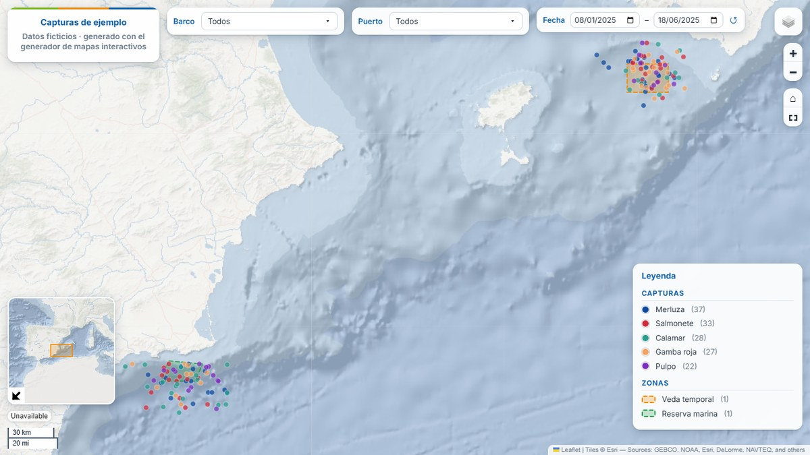
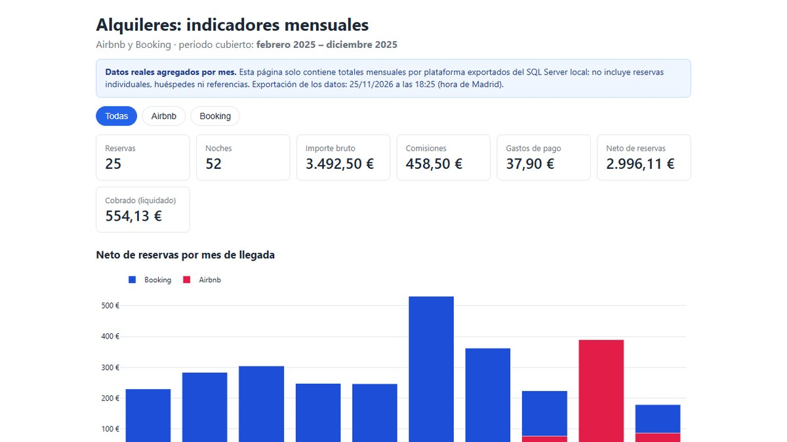
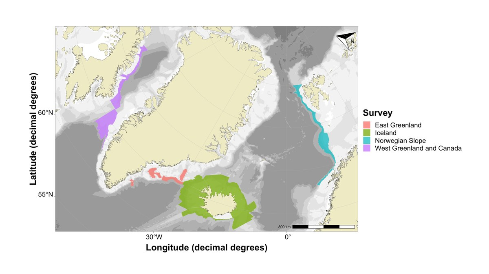
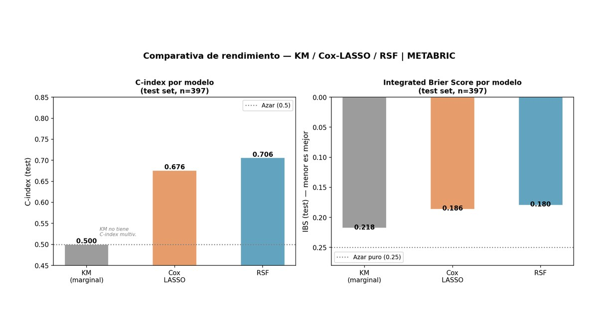
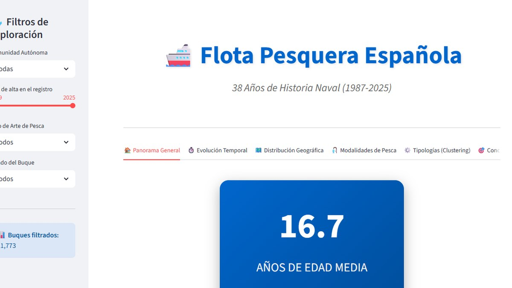
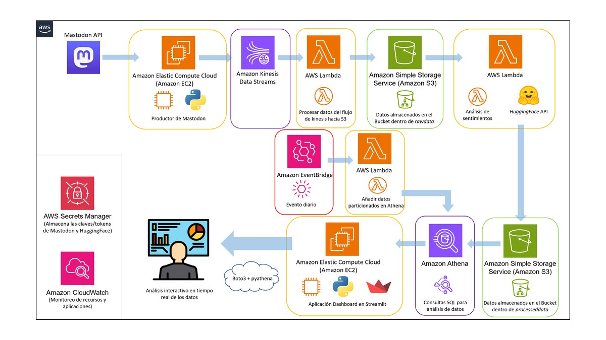
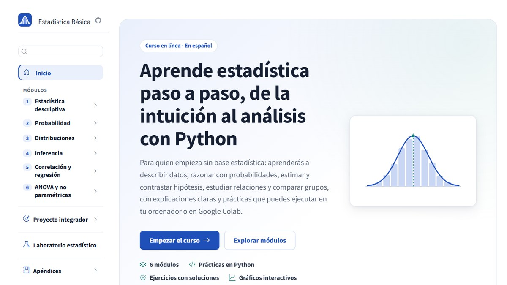

# Julio Úbeda Quesada

### Data Scientist

**Ingeniería de datos · Machine learning · Análisis geoespacial · Ciencias pesqueras**

  

Construyo procesos de datos de principio a fin: extracción y ETL, análisis estadístico, modelos de machine learning y visualización con Python, R, SQL y QGIS. Vengo de las ciencias del mar y la investigación pesquera, y hoy aplico ese conocimiento en Tragsatec con datos del Sistema de Información Pesquera Español (SIPE).

---

## Proyectos destacados

<table>
<tr>
<td width="50%" valign="top">

<h3><a href="https://github.com/JulioUQ/app-generador-mapas">🗺️ Generador de mapas interactivos</a></h3>
 

App en Streamlit que combina hojas de cálculo y capas GIS en un único HTML interactivo, con filtros, leyenda y capas para compartir sin instalar nada.

<code>Python</code> <code>Streamlit</code> <code>Folium</code> <code>GeoPandas</code>
</td>
<td width="50%" valign="top">

<h3><a href="https://github.com/JulioUQ/plataforma-analitica-local">📊 Plataforma local de analítica</a></h3>
 

n8n importa cada día hojas de cálculo a SQL Server y un dashboard en Dash presenta los indicadores mensuales. Publica solo agregados en GitHub Pages.

<code>n8n</code> <code>SQL Server</code> <code>Python</code> <code>Dash</code>
</td>
</tr>
<tr>
<td width="50%" valign="top">

<h3><a href="https://github.com/JulioUQ/investigacion-fletan-negro-marss">🐟 Estructura del fletán negro</a></h3>
 

Modelos MARSS sobre campañas de cuatro países para contrastar si los límites de gestión coinciden con la estructura de las poblaciones. Primer autor.

<code>R</code> <code>MARSS</code> <code>Series temporales</code>
</td>
<td width="50%" valign="top">

<h3><a href="https://github.com/JulioUQ/investigacion-supervivencia-cancer">🧬 Supervivencia en cáncer (TFM)</a></h3>

Kaplan-Meier, Cox-LASSO, Random Survival Forest y DeepSurv en cáncer de mama y pulmón, con validación externa entre cohortes independientes.

<code>Python</code> <code>scikit-survival</code> <code>PyTorch</code> <code>SHAP</code>
</td>
</tr>
<tr>
<td width="50%" valign="top">

<h3><a href="https://github.com/JulioUQ/app-dashboard-flota-pesquera">🚢 Flota pesquera española</a></h3>

Del dato a la aplicación en tres repositorios: <a href="https://github.com/JulioUQ/datos-web-scraping-flota">web scraping</a> de los registros de buques → <a href="https://github.com/JulioUQ/ml-flota-pesquera">limpieza y modelos</a> → <a href="https://github.com/JulioUQ/app-dashboard-flota-pesquera">dashboard en Streamlit</a> de 1987 a 2025.

<code>Selenium</code> <code>scikit-learn</code> <code>Streamlit</code> <code>Plotly</code>
</td>
<td width="50%" valign="top">

<h3><a href="https://github.com/JulioUQ/cloud-aws">☁️ Pipeline en streaming en AWS</a></h3>

Publicaciones de Mastodon en tiempo real: Kinesis, Lambda y S3, análisis de sentimiento con Hugging Face, consultas en Athena y dashboard en Streamlit.

<code>AWS</code> <code>Kinesis</code> <code>Lambda</code> <code>Athena</code>
</td>
</tr>
</table>

---

## Ruta de ciencia de datos

<table>
<tr>
<td width="40%" valign="top">

</td>
<td width="60%" valign="top">

Proyectos con la teoría necesaria para resolverlos, de la estadística descriptiva a los modelos generativos.

<b>1 · <a href="https://github.com/JulioUQ/Curso-de-Estadistica-Basica">Estadística básica</a></b>  Libro en Quarto con seis módulos, prácticas en Python y una librería propia con tests.

<b>2 · <a href="https://github.com/JulioUQ/curso-aprendizaje-automatico">Aprendizaje automático</a></b> Preparación de datos, clustering, modelos supervisados y ensembles.

<b>3 · <a href="https://github.com/JulioUQ/curso-deep-learning">Deep learning</a></b> CNN, RNN, transformers y modelos generativos con Keras y PyTorch.

</td>
</tr>
</table>

---

## Más proyectos

<table>
<tr>
<th width="18%"></th>
<th width="34%">Proyecto</th>
<th width="48%">Descripción </th>
</tr>
<tr>
<td></td>
<td><a href="https://github.com/JulioUQ/datos-hadoop-spark">Hadoop y Spark</a></td>
<td>Procesamiento por lotes con HDFS, RDDs, DataFrames y Hive</td>
</tr>
<tr>
<td></td>
<td><a href="https://github.com/JulioUQ/datos-streaming">Streaming</a></td>
<td>Kafka, Spark Streaming y Structured Streaming</td>
</tr>
<tr>
<td></td>
<td><a href="https://github.com/JulioUQ/viz-storytelling-reservas-hotel">Storytelling de reservas hoteleras</a></td>
<td>Narrativa visual sobre cancelaciones con Streamlit</td>
</tr>
<tr>
<td></td>
<td><a href="https://github.com/JulioUQ/Tecnicas_de_Visualizacion_de_Datos">Técnicas de visualización</a> · <a href="https://juliouq.github.io/Tecnicas_de_Visualizacion_de_Datos/">web</a></td>
<td>Sectores, velas japonesas y envolvente convexa con Plotly</td>
</tr>
<tr>
<td></td>
<td><a href="https://github.com/JulioUQ/curso-dashboards-dash">Dashboards con Dash</a></td>
<td>Callbacks, pestañas e informes en HTML y Excel</td>
</tr>
</table>

--- | --- | --- |
|  | [Hadoop y Spark](https://github.com/JulioUQ/datos-hadoop-spark) | Procesamiento por lotes con HDFS, RDDs, DataFrames y Hive |
|  | [Streaming](https://github.com/JulioUQ/datos-streaming) | Kafka, Spark Streaming y Structured Streaming |
|  | [Storytelling de reservas hoteleras](https://github.com/JulioUQ/viz-storytelling-reservas-hotel) | Narrativa visual sobre cancelaciones con Streamlit |
|  | [Técnicas de visualización](https://github.com/JulioUQ/Tecnicas_de_Visualizacion_de_Datos) · [web](https://juliouq.github.io/Tecnicas_de_Visualizacion_de_Datos/) | Sectores, velas japonesas y envolvente convexa con Plotly |
|  | [Dashboards con Dash](https://github.com/JulioUQ/curso-dashboards-dash) | Callbacks, pestañas e informes en HTML y Excel |

---

## Herramientas

<table>
<tr>
<th width="30%">Área</th>
<th width="70%">Tecnologías y métodos </th>
</tr>
<tr>
<td>Ciencia de datos</td>
<td>Python, R, pandas, scikit-learn, XGBoost, statsmodels</td>
</tr>
<tr>
<td>Deep learning</td>
<td>TensorFlow/Keras, PyTorch, Hugging Face</td>
</tr>
<tr>
<td>Ingeniería de datos</td>
<td>SQL, SQL Server, PostgreSQL, n8n, Spark, Kafka, Docker</td>
</tr>
<tr>
<td>Cloud</td>
<td>AWS (EC2, Lambda, Kinesis, S3, Athena)</td>
</tr>
<tr>
<td>Visualización</td>
<td>Plotly, Dash, Streamlit, Quarto, Power BI</td>
</tr>
<tr>
<td>Análisis geoespacial</td>
<td>QGIS, PostGIS, GeoPandas, Folium</td>
</tr>
</table>
